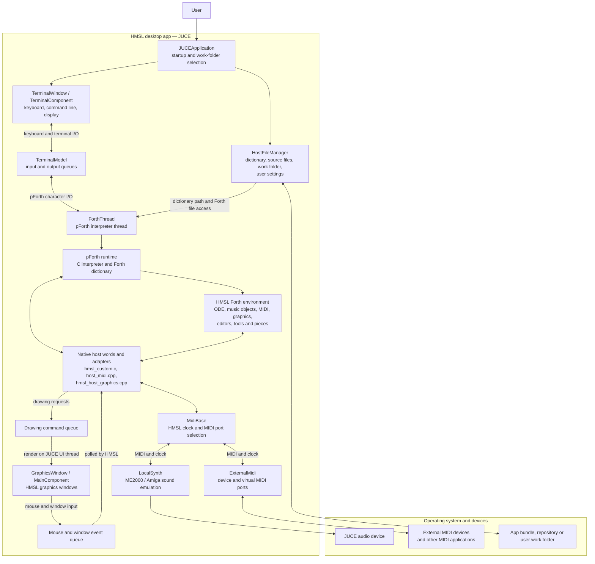
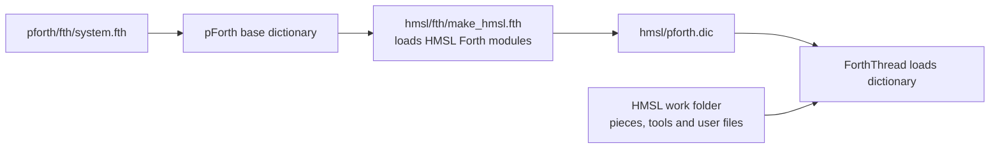

# HMSL App Architecture

This diagram describes the current JUCE app (`native/juce`), which runs the
HMSL Forth environment on pForth. The older Objective-C macOS and Win32 ports
are separate implementations and are not part of this runtime.

## Dictionary build

The app's `--build-dictionary` mode first runs pForth's
`pforth/fth/system.fth`, then loads `hmsl/fth/make_hmsl.fth` to compile the
HMSL sources on top of pForth and save `hmsl/pforth.dic`. The regular runtime
loads that dictionary and uses the selected HMSL work folder for Forth files.

The JUCE application and its adapters are in `native/juce/Source`; HMSL's
Forth module load order is defined in `hmsl/fth/load_hmsl.fth`. See
[Building HMSL](build.md) for the build and packaging workflow.
